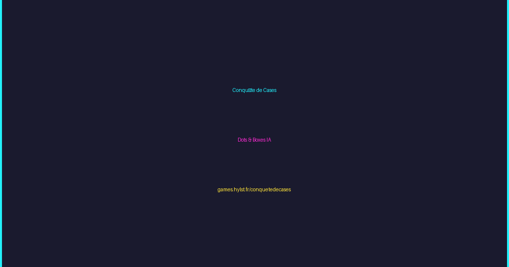

# Conquête de Cases

**Le classique des points et des cases, avec une vraie campagne et une IA qui calcule les coups pièges.**

Joue ici : [games.hylst.fr/conquetedecases/](https://games.hylst.fr/conquetedecases/)



## Comment on joue

Cliquez sur un trait entre deux points pour le tracer. Fermer le 4e côté d'une case vous la
capture et vous rejouez immédiatement. Le joueur avec le plus de cases à la fin de la grille
gagne. Campagne de niveaux progressifs, chacun avec sa propre taille de grille et son propre
réglage de difficulté pour l'IA.

## Contrôles

| Action | Effet |
|--------|-------|
| Clic sur un trait entre deux points | Tracer ce trait |
| Fermer le 4e côté d'une case | Capture la case et rejoue |
| Bouton « ℹ️ Infos » | Stack technique, graphismes, algorithmes |

## Ce qu'il y a dedans

- Campagne de niveaux progressifs, taille de grille et difficulté croissantes
- IA qui évalue chaque coup avec une heuristique plutôt qu'une recherche exhaustive : elle
  estime le risque d'offrir une chaîne de cases à l'adversaire et privilégie les coups qui
  limitent ce risque tout en maximisant ses propres captures en chaîne
- Musique d'ambiance et effets sonores synthétisés
- Rendu DOM/CSS (dégradés, animations de capture), aucun Canvas

## L'arborescence

```
dots-and-boxes-ai-game-game-development/
├── index.html          # template + bloc SEO
├── vite.config.ts      # base '/conquetedecases/' + singlefile
├── favicon.png
├── og-image.png
└── src/
    ├── main.tsx
    ├── App.tsx          # état du jeu, IA, UI
    ├── index.css
    └── utils/cn.ts
```

## Dev

```bash
npm install
npm run dev       # http://localhost:5173/
npm run build     # dist/index.html, un seul fichier
npm run preview
```

## Stack

React 19, TypeScript 5.9 (strict), Tailwind CSS 4, Vite 7, vite-plugin-singlefile.

## Licence

AGPL-3.0-or-later, Geoffroy Streit (Hylst). Voir `LICENSE`.
